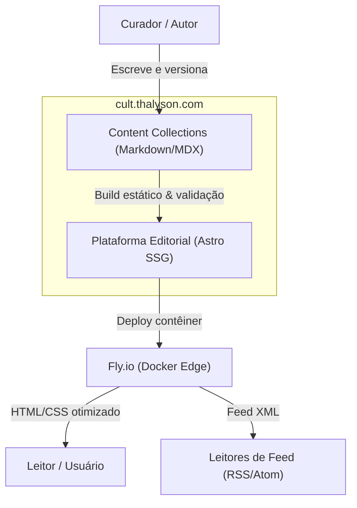
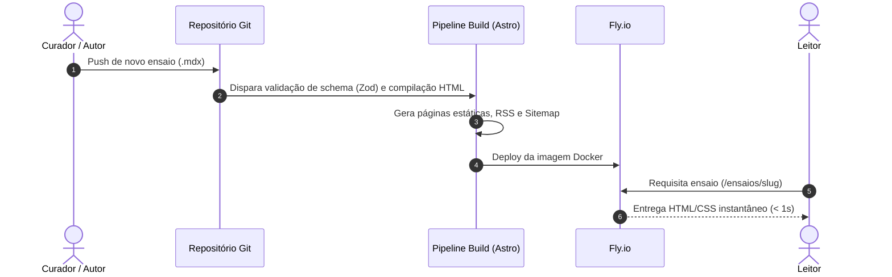
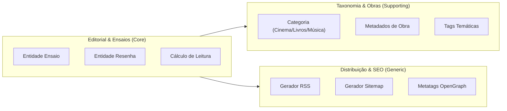

# Diagramas de Arquitetura — cult.thalyson.com

> Visão visual do sistema em Mermaid. Atualize ao modificar a arquitetura.

## 1. Visão de Contexto do Sistema (C4 Nível 1)

## 2. Fluxo de Publicação e Leitura (Sequência)

## 3. Estrutura de Bounded Contexts e Camadas

